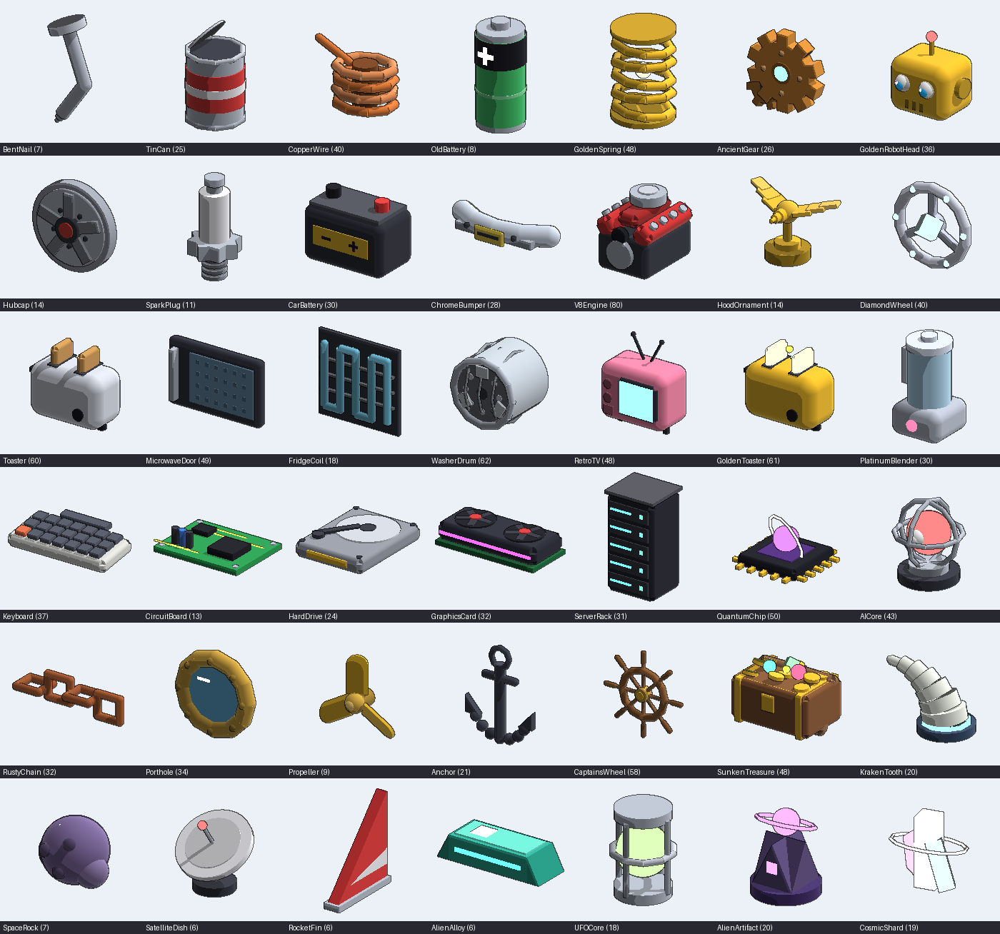
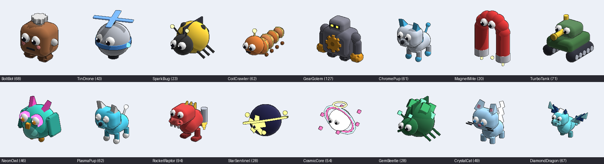
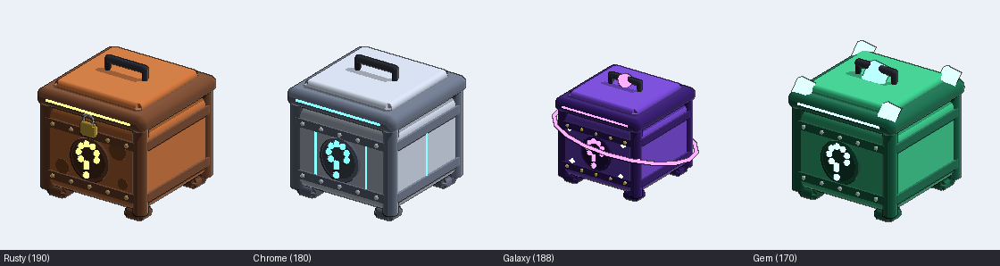
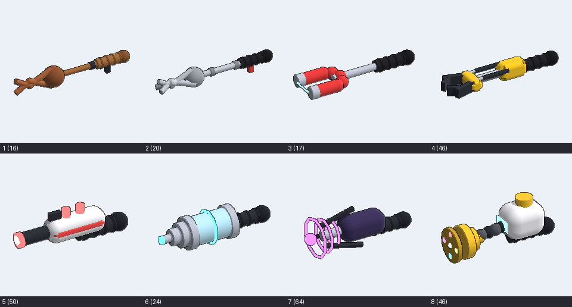
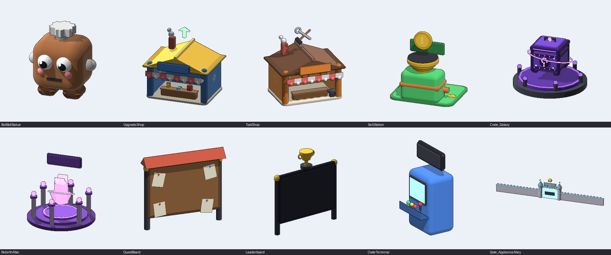

# Junkyard Simulator

A Roblox simulator with chunky, Pet-Simulator-style models: start broke in a scrapyard, grab junk, sell it, upgrade your gear, unlock six themed yards, hatch Scrap Bots, and rebirth for permanent boosts.

## Open it in Roblox Studio (one click)

1. **[Download JunkyardSimulator.rbxl](https://github.com/EliteBlackIce/Roblox-Game/raw/claude/quirky-meitner-5aljnc/JunkyardSimulator.rbxl)**
2. Double-click the file. Studio opens with the whole map, every script and the lighting already set up.
   (If double-clicking doesn't open Studio, open Studio and use **File → Open from File…**.)
3. Press **Play** (F5).

To put it on Roblox, use **File → Publish to Roblox**, then turn on *Game Settings → Security → Enable Studio Access to API Services* so saving and the global leaderboard work.

## Art

Every model is built from Roblox parts in one soft, cel-shaded cartoon style. Shapes are balls, capsules and smooth rings that melt into each other, with no hard boxes on pets or tools. Colours are flat (SmoothPlastic), Neon is used for glow, and nothing has realistic textures. Toon lighting removes the environment shading and keeps shadows crisp. Ink outlines are drawn with Highlights on the nearest models and with a dark backing silhouette in UI viewports. The shared art kit is in `src/shared/Art/`.

| | |
|---|---|
| **42 scrap items**, one per item in the game. They sit on the piles, fly into your hands when you grab them, and show in the Index. |  |
| **20 Scrap Bots**: chibi pets with sparkly eyes, blush and little props (a wind-up key, a propeller beanie, rainbow wings...), plus golden variants. That includes **4 SECRET pets**: Trash King, Prism Phoenix, Nebula Whale and Kaleido Kitty. |  |
| **4 crates** with lids that blast off when you open one. |  |
| **8 tools** made of soft melded shapes, from a wooden grabber to the pearly Quantum Vacuum. |  |
| **Stations**: barrel-roof cottage shops, each with a pet shopkeeper, plus Scrap Buyer machines, crate pedestals, the rebirth altar, castle gates and a giant BoltBot statue. |  |

Animations:
- **Crate opening:** a full 3D hatch in front of the camera, with blur, colour grading and camera shake. The crate drops in, bounces and charges up, then shatters in a shockwave, and the pet spins out in front of rarity-coloured rays. Legendary and Mythic hatches add extra charge pulses, a slam-in title and confetti. A **SECRET** hatch blacks out the screen, shows "? ? ?", cracks the crate with rainbow light and three lightning strikes, then explodes into "SECRET!!!".
- **Collecting:** your tool points forward from your hand and scoops down, and a mini 3D copy of each item hops from the pile into you. Legendary and Mythic finds show the item in a big banner.
- **World:** crates hover and spin on their pedestals, the coins on the Scrap Buyers spin, and the gate emblems, rebirth crystal and trophy float.
- **Bots:** walkers hop after you and flyers bob along beside you.
- **Ambient life:** clouds drift overhead, butterflies flutter around you, and glowing motes float in the air. Every zone is scattered with grass tufts, flowers and loose junk. All of this switches off with *Low Effects*.

UI:
- Bright, bubbly Pet-Sim-style panels with thick ink outlines, glossy buttons, Fredoka text and pill-shaped currency counters.
- Menu buttons, the Index, the Bots window and the Tool Shop all show live 3D models.
- Undiscovered Index items appear as black silhouettes.

To preview the models without Studio: `tests/preview/preview.sh Items out.png` (or `BotArt`, `CrateArt`, `ToolArt`, or `map <ModelName> --single`).

## What's in the game

### Core loop
- Hold **E** on scrap piles to grab junk. Each pile gives 3-6 grabs and respawns 18 seconds after it empties.
- Your backpack fills up. Sell at the green **SELL** pad in any zone.
- Spend cash on **Upgrades** (Backpack, Quick Hands, Lucky Gloves, Speedy Sneakers) and better **Tools** (8 tiers, from Rusty Grabber to Quantum Vacuum).

### 6 yards, 42 items
| Zone | Unlock | Theme |
|---|---|---|
| Scrap Heap | free | rusty heaps, barrels, tires |
| Car Graveyard | $750 | wrecked cars, car stacks, crusher |
| Appliance Alley | $6K | fridges, washers, a giant toaster and TV |
| Electronics Dump | $40K | server racks, glowing circuit traces, giant monitor |
| Shipyard Wrecks | $250K + Rebirth 1 | sea, docks, boat wrecks, lighthouse |
| Crash Site | $1.5M + Rebirth 2 | UFO crater, rocket wreck, neon crystals |

Every zone has 7 items across Common, Uncommon, Rare, Epic, Legendary and Mythic. **Mythics only drop from Golden Piles.**

### Systems
- **Scrap Bots (pets):** 4 crates in the Hub (Rusty, Chrome and Galaxy for cash, Gem for gems) hold 20 bots (including one ultra-rare SECRET per crate) that boost cash and luck. They follow you around as little chibi pets. You can equip 3 (more with perks or passes), use *Equip Best*, merge 5 copies into a **Golden** bot (x2.5 stats), or delete bots.
- **Rebirth:** reset cash, upgrades, tools and zones for **+50% cash forever** and Rebirth Tokens. Tokens buy perks: Extra Bot Slot, Lucky Charm, Head Start, Remote Sell (sell anywhere), Auto Grabber (collects automatically) and Tool Insurance.
- **Quests:** an 18-step quest chain that teaches the game, 3 daily quests (with a bonus for finishing all three), and a 7-day login streak.
- **Scrap Index:** a collection book. Completing a zone's set gives +5% cash, and each Mythic found gives +10%.
- **Live events:**
  - A Golden Pile spawns every 2-3.5 minutes. It drops Rare or better, gives gems, and has a 3% Mythic chance.
  - Scrap Frenzy runs every 12 minutes: x2 cash and faster grabs for 90 seconds.
  - The whole server sees a banner when anyone finds a Legendary or Mythic.
- **Boosts:** spend gems on x2 Cash, x2 Luck or Turbo Grab (10 minutes each; buying again stacks the time).
- **Teleport** to any zone you've unlocked, **Codes**, **Settings** (sound, hide other bots, low effects), a global **Top Earners** board, and overhead rank tags.

### Codes
`RELEASE`, `JUNKYARD`, `SCRAPPY`, `LUCKYDAY`, `THANKYOU`. Add more in `src/server/Services/CodeService.luau`.

## Making money from it (optional)
Create game passes and developer products in the Creator Dashboard, then paste their IDs into `Config.GamePasses` / `Config.Products` in `src/shared/Config.luau`. Anything left at `0` stays switched off, and the **Store** button only appears once at least one ID is set. Ready-made passes: x2 Cash, Mega Backpack, +2 Bot Slots and VIP. Ready-made products: three gem packs.

## Tuning
All numbers live in `src/shared/`:
- `Config.luau`: cooldowns, events, boosts and monetization
- `Zones.luau`: zones, items, values and drop weights
- `Tools.luau` and `Upgrades.luau`
- `Bots.luau`: bots, crates and odds
- `Rebirth.luau`: cost curve and perks
- `Quests.luau`

## Project layout
```
src/shared/   Catalogs (Config, Zones, Tools, Upgrades, Bots, Rebirth, Quests), Formulas, Remotes
src/shared/Art/ Kit (rounded primitives), Items, BotArt, CrateArt, ToolArt (all 3D models)
src/server/   Main.server.luau
              Services/  Data, RequestRouter, Scrap, Economy, Bot, Rebirth, Quest, Event,
                         Code, Leaderboard, Monetization, Character, Tool, Stations
              World/     MapBuilder, StationArt, Props, Builder (the map generator)
src/client/   Main.client.luau, State, Effects, BotFollowers, Gates, WorldAnimator
              UI/        Hud, Menu, Notifications, Hatch, Windows, Theme, Viewport
              UI/Screens/ Upgrades, Tools, Bots, Quests, Index, Rebirth, Boosts, Teleport, Codes, Settings, Store
map/          The baked map and lighting (generated by tests/bake.sh)
tests/        Headless playtest against a mock Roblox engine, plus tests/preview (model renderer)
```

## Security model
The server owns all game state. The client can only:
- trigger ProximityPrompts. The server checks distance, cooldown, that the tool is equipped, that the zone is unlocked, and free space.
- call one `Request(action, ...)` remote. The server routes it to a known handler, rate-limits it per action, type-checks every argument, and looks up every price, balance and distance itself.

Cash, prices, items, bots and upgrade effects are never read from the client. Saves are sanitized on load, and old (v1) saves migrate automatically. Paid purchases are de-duplicated by receipt and saved immediately.

## Development
```bash
tests/run.sh    # headless playtest: 215 checks covering every system (needs Rust/cargo)
tests/bake.sh   # regenerate map/ from MapBuilder and rebuild JunkyardSimulator.rbxl (needs cargo + Rojo)
selene src      # lint
rojo serve      # live-sync into Studio with the Rojo plugin
```
